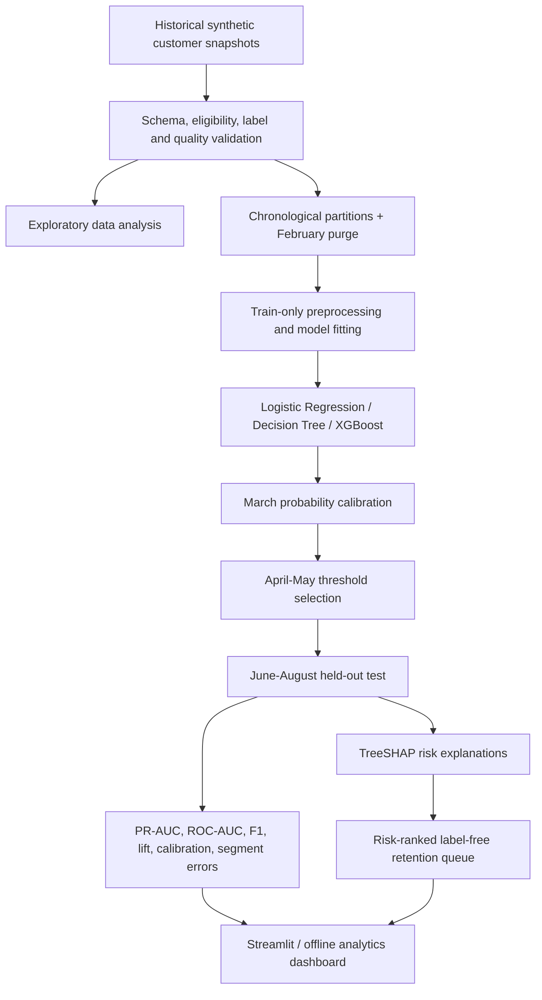

# Customer Churn Prediction & Retention Prioritization

**HCLTech Future Ready Data Science Hackathon | Research-guided machine learning prototype**

ATLAS is a decision-support application that estimates a customer's probability of churn during the next **30 days**, explains the signals associated with that prediction, and produces a risk-ranked list for human retention review. The solution combines **XGBoost**, **Logistic Regression**, and **Decision Tree** models with chronological validation, probability calibration, risk-driver explanations, and outreach-capacity analysis.


## 1. Problem and objectives

Retail, telecom, and subscription providers need to recognize customers at risk of discontinuing a service and decide whom to review when the retention team has limited capacity. The HCLTech use case calls for:

- Clear churn-event and eligibility definitions.
- Leakage-safe customer-level risk scores between 0 and 1.
- Chronological model evaluation on a later held-out test period.
- Adjustable risk thresholds or review-capacity limits.
- Portfolio and individual customer risk explanations.
- A ranked retention-review queue and top-k lift/capture analysis.
- Segment-level performance analysis and reproducible documentation.

The system **recommends review priority**; it does not automatically contact customers, change prices, modify contracts, or claim that any churn was prevented.

## 2. Solution workflow



## 3. Dataset and prediction definition

| Property | Definition |
|---|---|
| Records | **1,800** synthetic customer snapshots |
| Columns | **32** total; **28** pre-prediction model features |
| Target | `churn_label`: **1 = Churned**, **0 = Retained** |
| Target balance | **900 churned / 900 retained** |
| Sectors | Retail, Telecom, Subscription |
| Time coverage | January 2025 – August 2026 (20 monthly cohorts) |
| Prediction point | First day of each month |
| Observation window | Prior **90 days** |
| Churn event | Cancellation or failure to renew during days **+1 through +30** |
| Eligibility | Active at prediction and `tenure_months >= 3` |
| Data quality checks | No missing cells or duplicate customer IDs in the supplied dataset |

The generator uses rule-guided probabilistic simulation for historical usage, engagement, billing, customer support, plan, and account features. It uses a simulated churn-risk process to sample binary outcomes, then balances the candidate data by **month × industry × plan tier**: five churned and five retained records in each cohort. This is **stratified synthetic sampling**, not SMOTE. The fixed random seed is documented in `src/generate_dataset_reference.py`.

Some important pre-cutoff features are `tenure_months`, `contract_type`, `plan_tier`, `usage_change_pct`, `engagement_change_pct`, `billing_issues_90d`, `failed_payments_90d`, `unresolved_tickets_at_cutoff`, `plan_suitability_score`, and `renewal_due_in_days`. See `data/customer_churn_data_dictionary.csv` for the full schema.

**Leakage prevention:** Never include `churn_label`, future outcomes, the separate explicit-label audit CSV, `customer_id`, `prediction_date`, or `data_split` in model inputs. All feature transformers are fitted on historical training rows only. Each customer appears in one snapshot, not as a longitudinal panel.

## 4. Project structure

```text
HCLTech_Churn_Full_Source_Code/
├── app.py                              # Six-page Streamlit dashboard
├── run_all.py                          # One-command pipeline orchestration
├── requirements.txt                    # Python dependencies
├── data/
│   ├── customer_churn_1800_dataset.csv
│   ├── customer_churn_1800_explicit_labels.csv  # Audit only; do not train on it
│   └── customer_churn_data_dictionary.csv
├── src/
│   ├── eda_report.py                   # Data checks, EDA summaries, charts
│   ├── train_and_evaluate.py           # Train, calibrate, test, SHAP, queue
│   ├── make_figures.py                 # Evaluation figures
│   ├── build_offline_dashboard.py      # Portable interactive HTML
│   ├── validate_outputs.py             # Output/contract validations
│   ├── score_new_customers.py          # Batch inference and fresh SHAP
│   ├── tune_xgboost.py                 # Optional historical parameter search
│   └── generate_dataset_reference.py   # Optional synthetic-data regeneration
├── samples/new_customers.csv           # Example label-free scoring input
├── tests/test_pipeline.py              # Six automated tests
├── design/                              # Editable Excalidraw designs
├── docs/TECHNICAL_SPECIFICATION_CODE_MAP.md
└── outputs/                             # Generated scores, models, figures, reports
```


## 5. Model training and leakage-safe validation

The project deliberately **does not use a random train/test split**. The saved model follows these time-ordered stages:

| Partition | Dates | Rows | Purpose |
|---|---|---:|---|
| Historical train | Jan 2025 – Jan 2026 | **1,170** | Fit preprocessing and classifiers |
| Purged gap | Feb 2026 | **90** | Exclude to avoid immature target labels |
| Calibration | Mar 2026 | **90** | Calibrate output probabilities |
| Threshold validation | Apr – May 2026 | **180** | Select threshold under a 30% review-capacity constraint |
| Held-out test | Jun – Aug 2026 | **270** | Report final unbiased-by-selection retrospective metrics |

The models are:

1. **XGBoost** — paper-inspired primary model, based on gradient-boosted trees.
2. **Logistic Regression** — interpretable baseline with standardized numeric inputs.
3. **Decision Tree** — simple nonlinear baseline.

Categorical fields are one-hot encoded; preprocessing is fitted on the historical training partition. Probability calibration uses a logistic/sigmoid mapping fitted on March data. Threshold selection uses April–May data, maximizing F1 subject to **at most 30%** of customers being flagged. The held-out test is not used for tuning.

The code computes **TreeSHAP-style XGBoost contributions** (from the XGBoost booster) for portfolio-level and customer-level explanations. These additive contributions are expressed in **uncalibrated log-odds**, not percentage-point changes in calibrated risk; they are associations, not proof of causation.

## 6. Evaluation snapshot

The following results are from the bundled evaluation report, on the **270-row synthetic June–August 2026 held-out test**. Thresholds were selected on validation data.

| Model | PR-AUC / Average Precision | ROC-AUC | Precision | Recall | F1 |
|---|---:|---:|---:|---:|---:|
| XGBoost | 0.645 | 0.666 | 0.643 | 0.400 | 0.493 |
| Logistic Regression | **0.701** | **0.679** | **0.716** | **0.430** | **0.537** |
| Decision Tree | 0.428 | 0.393 | 0.333 | 0.148 | 0.205 |

On these synthetic records, **Logistic Regression outperforms XGBoost**; do not substitute the research paper's published accuracy for this project's result. The pipeline also produces a confusion matrix, Brier score, calibration bins, threshold error counts, segmented results, and top-k capture/lift analyses.

For illustration, the XGBoost top-**20%** review queue contains **54 of 270** test customers and captures **38 of 135** actual churners (precision@k **70.4%**, recall@k **28.1%**, lift@k **1.41×**). These are **identified churners, not proven retained customers**.

## 7. Dashboard and primary deliverables

Start the application with `python -m streamlit run app.py`. The six available sections are:

- **Overview:** Cohort KPIs, charts, and portfolio risk distribution.
- **Retention Queue:** Risk-ranked customers, threshold or fixed top-k capacity, label-free export.
- **Model Evaluation:** PR-AUC, ROC-AUC, calibration, threshold errors, and lift.
- **Risk Explanations:** Global feature importance and individual risk/protective signals.
- **Data Quality:** Eligibility, uniqueness, class balance, and chronology checks.
- **Score New Customers:** Upload a compatible customer CSV and generate risk scores with fresh local explanations.

The five expected hackathon deliverables map to the project as follows:

| Deliverable | Evidence |
|---|---|
| D-01 — Scoring prototype | `app.py`, `src/score_new_customers.py`, `outputs/model_XGBoost.joblib` |
| D-02 — EDA and driver analysis | `outputs/eda_report.md`, `outputs/eda_overview.png`, `outputs/global_risk_drivers.csv` |
| D-03 — Chronological evaluation | `outputs/evaluation_report.md`, figures, calibration, lift, thresholds and segment CSVs |
| D-04 — Retention prioritization | `outputs/retention_priority_queue.csv`, Streamlit and offline dashboard |
| D-05 — Documentation | This README, data dictionary, technical code map, tests and generator |

All **FR-01 through FR-09** are mapped to source functions and output files in `docs/TECHNICAL_SPECIFICATION_CODE_MAP.md`.

## 8. Score new customer records

First run the training pipeline so `outputs/model_XGBoost.joblib` exists. Then execute:

```powershell
python src/score_new_customers.py --input samples/new_customers.csv --output outputs/my_scores.csv
```

Input CSVs must contain all **28 historical predictor columns**, plus optional `customer_id` and `prediction_date`. Do **not** include actual churn labels or future outcome columns. Required inputs must be non-null, numeric fields finite, and `tenure_months >= 3`. The script checks for duplicated IDs and invalid fields.

Output includes `retention_priority_rank`, `risk_probability`, `risk_percentage`, `risk_band`, `flag_at_validation_threshold`, historical evidence, estimated monthly charge exposure proxy, `top_risk_drivers` and `top_protective_signals`. This is a **review queue, not an automatic intervention workflow**.


## 9. Limitations and responsible use

- **Synthetic labels and forced 50/50 prevalence:** Real customers may have much lower churn prevalence; precision, lift, and risk calibration would change.
- **No causal retention evidence:** A correctly identified churner is not equivalent to a customer saved by outreach; revenue exposure is a **proxy** based on monthly charges.
- **Small time partitions:** Only 90 samples for calibration and 270 for test; estimates may be unstable.
- **One snapshot per customer:** The dataset does not track repeated observations of the same customer across months.
- **Explainability is associative:** SHAP contributions do not prove that changing a feature will prevent churn.
- **Prototype scope:** No production authentication, operational monitoring, automatic outreach, or live enterprise system integration is implemented.
- **Safety and fairness:** Protected traits are not used in the synthetic feature set. Real deployment requires privacy review, fairness assessment, and measurement on representative customer data.


